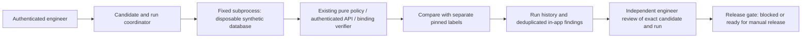

# Phase 04 engineering assurance API

The existing `backend.app.api:create_app --factory` enables the engineering API.
All routes below require bearer authentication and a current active ENGINEER in
the tenant. Business roles cannot access these records. Engineering access is
tenant-wide for synthetic security records; business job/approval permissions
remain separate and unchanged. Every read/mutation is scoped and audited.

## Architecture and isolation



The subprocess has a fixed module/argument interface, a minimal environment that
omits provider keys, a 20-second timeout, no external sockets and no shell/code
upload. Each worker uses its own temporary SQLite/media directory. It writes no
operational case/policy/approval in the caller's repository. No approval row or
business action is created even in its disposable database. Approval binding
scenarios use read-only fictional snapshot rows against the real verifier;
they are not new authenticated manager sign-offs. Role/tenant/assignment/replay/
stale-version/concurrent mutation scenarios use real authenticated TestClient API
requests. Existing baseline tests retain actual approval/concurrency coverage.

The normal factory enables assurance by default. The historical internal
`backend.testing.create_test_app` explicitly disables it to retain its Phase 01
no-red-team route contract. The isolated worker also disables nested assurance.
Current Phase 04 tests and the TCP smoke use the normal enabled factory; its real
OpenAPI/bearer protection is tested separately. No test detects pytest or hides
routes dynamically, and no existing test assertion was changed.

## Reference corpus and scoring

`fixtures/security/scenarios_v1.json` defines input mutations;
`labels_v1.json` independently stores fixed expected outcomes; `manifest_v1.json`
pins both files. Generation, labeling, execution and comparison are separate
modules. Labels are never obtained from the SUT. Duplicate/conflicting inputs or
labels, orphan labels, pending candidates and unreviewed HUMAN_LABELED artifacts
are rejected. The initial corpus is SYNTHETIC / SPECIFICATION_REFERENCE, derived
from accepted Master Book requirements, not an independently human-reviewed
customer dataset or live AI output. Additional human labeling is not claimed.

There are 38 cases: 24 pure-policy, nine authenticated API and five read-only
approval-binding snapshots. Named scenarios cover all requested attack categories
and legitimate progression. NaN/infinity are explicit mutation tags materialized
only at the SUT boundary; the source JSON remains standards-compliant.

Positive binary class means **should DENY**: TP=correct invalid denial,
FN=false approval, TN=correct valid allowance, FP=false rejection.
FAR=FN/(TP+FN), FRR=FP/(TN+FP); zero denominators are JSON null (N/A).
Expected NEEDS_REVIEW and actual review/abstention for binary-expected cases are
excluded from these binary denominators and counted separately. Review bypasses
are separate failures, never hidden as correct denials. A case passes only if
decision, applicable HTTP/inspection/permission fields and required reason codes
all match. Wrong SAFETY_ALERT/REVIEW_REQUIRED status fails even when restricted.
Missing, interrupted or unevaluable mandatory results block the gate.

Test-only profiles are SAFE_BASELINE (source 30–40 PSI fictional bounds),
WEAK_TEST_ONLY (max 50), OVERRESTRICTIVE_TEST_ONLY (min 36). They are constructed
in memory for isolated tests; never written under production `policies/` or
registered in operational policy tables. Candidate metadata contains profile,
version, hash and author. Hash binds profile/configuration/revision plus all
backend app source files. Run/review/gate also bind the corpus hash. No policy
threshold or model output may redefine an expected label.

## Endpoints

All paths consistently use `/v1/`; there is no `/api/v1` alias. JSON request bodies
retain the existing 16-KiB bound and extra-field rejection. Pages use `limit` 1–50
(default 25), scoped public `before` cursor, descending creation time/ID ordering.
UUIDs are references, never authorization. Cross-tenant references return 404;
wrong roles 403; absent/expired session 401; invalid inputs 422.

| Method/path | Body/query and behavior |
|---|---|
| POST `/v1/redteam/candidates` | `{profile}` source enum only; creates isolated test candidate revision 1/review revision 0. |
| GET `/v1/redteam/candidates` | Bounded page of scoped candidate metadata. |
| GET `/v1/redteam/candidates/{id}` | Exact artifact/software hashes and current binding validity; always test_only/published=false. |
| PATCH `/v1/redteam/candidates/{id}` | `{expected_version,profile}` CAS; advances artifact version and resets review revision; old decisions become stale. |
| POST `/v1/redteam/run` | `{candidate_id,expected_candidate_version,idempotency_key,trigger?}`; full pinned corpus only. Trigger is PRE_RELEASE, MANUAL_PERIODIC or TARGETED_SYNTHETIC. |
| GET `/v1/redteam/runs` | Page, optional candidate_id filter. |
| GET `/v1/redteam/runs/{id}` | Recorded hashes/status, full bounded safe results, metrics and current artifact binding validity. |
| POST `/v1/redteam/suggest` | Authenticated/audited BLOCKED, GEMINI_FROZEN, candidates=[]; no live or canned AI suggestion claim. |
| GET `/v1/alerts` | In-app restricted findings feed; severity/status/policy_id filters and paging. |
| GET `/v1/alerts/{id}` | Expected/actual fields, severity rationale, reproduction steps, up to 100 occurrence/proposal records and run links; truncation flag. |
| POST `/v1/alerts/{id}/triage` | `{expected_version,status,reason,gate_id?}`; CAS, audit, safe enum reason; dismissal needs explicit disposition. VERIFIED requires this finding's current accepted remediation gate. |
| POST `/v1/alerts/{id}/remediations` | `{expected_version,candidate_id,expected_candidate_version,remediation}`; records candidate-only proposal; no rule/code upload or publication. |
| POST `/v1/redteam/candidates/{id}/reviews` | `{expected_version,expected_review_version,proposal_id,run_id,decision,reason}`; independent ENGINEER distinct from candidate/proposal author. Bound to exact artifact, full run and corpus. |
| POST `/v1/redteam/candidates/{id}/release-gate` | `{expected_version,run_id,review_id?}`; computes gate from current complete run and independent active review. |
| GET `/v1/redteam/release-gates/{id}` | Immutable historical decision plus effective current decision/binding validity; stale historical readiness returns effective BLOCKED. |
| GET `/v1/redteam/audit` | Tenant-scoped bounded logical events, optional subject_id filter. |

Typed requests/responses are in `assurance_models.py`. Run statuses: RUNNING,
INTERRUPTED, COMPLETE, FAILED, STALE. A completed test execution can contain
regression failures; COMPLETE alone is not a passing gate. Run keys are 16–128
URL-safe characters, hashed at rest and scoped to tenant/actor. Same-request replay
does not spawn again or duplicate findings; a pending replay returns HTTP 202.
Changed request/key binding returns IDEMPOTENCY_CONFLICT. RUN_IN_PROGRESS,
ASSURANCE_RATE_LIMIT, CURRENT_COMPLETE_RUN_REQUIRED and VERSION_CONFLICT provide
safe reload/wait guidance. A changed source requires a candidate revision/rerun.

Review and artifact revisions are separate. Two reviews at the same expected
review revision have one CAS winner. A later rejection, changed candidate/source/
corpus or disabled reviewer invalidates earlier readiness. Findings deduplicate
by tenant/artifact/corpus/scenario/expected/actual/mismatch fingerprint while each
run occurrence remains. Dismissal never deletes or changes a failed result.
Findings include only safe enums/references, not raw media, tokens, challenges,
injection text or provider payloads. This is an in-app API feed, not external mail.

## Gate and limits

READY_FOR_MANUAL_RELEASE requires a complete current corpus run, no mandatory
mismatch/unevaluable result, no false approvals/review bypasses, valid-case
acceptance and exact independent human-account review. Otherwise BLOCKED or a
conflict requiring a fresh complete run. Every response has published=false.
This MVP is a readiness decision, not a deployment/CI publication pipeline. The
existing trusted offline policy registrar retains its prior controls and does
not consume or auto-publish these candidate fixtures. Production release
integration remains future work; no enforcement over privileged file edits is
claimed.

Each run has at most 64 scenarios (current 38), a 20-second child deadline and a
512-KiB output check. One active run per tenant is enforced with a bounded recent
history query; the ten-runs/five-minute per-engineer guard also uses that recent
tenant window, not a distributed/global abuse limiter. Reads are bounded; total
history retention/disk quotas are not implemented. Child stdout is buffered before
its size check, so this is trusted-code process separation, not an OS memory or
hostile-code sandbox. No arbitrary executable input is accepted.

Security schema namespace v1 is additive; core/media/workflow v1 unchanged.
Runs/results/occurrences/proposals/reviews/gates/events reject ordinary UPDATE/
DELETE. Candidate and finding mutations use explicit versions in transactions.
Database owners can alter files/triggers; no tamper-proof ledger claim. A crash
can leave a reserved run INTERRUPTED, never a false PASS; no background resume.

Test triggers: mandatory proposed-policy pre-release, manual periodic runs, and
targeted synthetic investigations. No scheduler or customer-data import is
implemented. Sampled post-checkout audits would be future retrospective checks,
not prevention of an already completed action.

## Windows reproduction

```powershell
Set-Location D:\project\sentinel_ladder_v2
$phase04Temp = Join-Path (Resolve-Path .venv).Path ('phase04-check-' + [guid]::NewGuid().ToString('N'))
New-Item -ItemType Directory -Path $phase04Temp | Out-Null
$env:TEMP = $phase04Temp
$env:TMP = $phase04Temp
$env:TMPDIR = $phase04Temp
.\.venv\Scripts\python.exe -m pytest backend/tests/phase04 -q -p no:cacheprovider --basetemp (Join-Path $phase04Temp 'pytest')
.\.venv\Scripts\python.exe -m backend.tools.smoke_phase04
.\.venv\Scripts\python.exe -m pip check
```

Use a new GUID directory for each new pytest invocation. This avoids the recovered
Windows Temp permission issue; no system ACL or unrelated temp file is changed.
Startup (no cloud/key/Docker/WSL needed), from an otherwise unmodified shell:

```powershell
.\.venv\Scripts\python.exe -m backend.tools.manage init-demo
.\.venv\Scripts\python.exe -m backend.tools.manage create-user --tenant demo-a --username engineering_reviewer --role ENGINEER
.\.venv\Scripts\python.exe -m uvicorn backend.app.api:create_app --factory --host 127.0.0.1 --port 8000
```

Provisioning prompts for independent hidden passwords. Login/authorize in local
Swagger; use the ENGINEER and independent reviewer accounts. The normal default
provider remains DISABLED; do not load live-provider flags. Gemini troubleshooting
and all further live calls remain deferred until Phases 04–07 finish. The consumed
marker and previous failed result are preserved. No Phase 05 UI is implemented.
