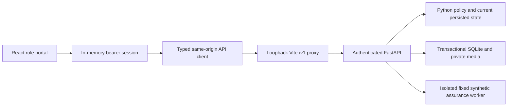

# Phase 05 portal architecture and contracts

Three portals consume authenticated `/v1` APIs. FastAPI remains the sole authority
for role, tenant, assignment, challenge, L-level, exact approval binding, actions
and engineering readiness. No permission rule, provider or baseline test changed.

Modules: `src/App.tsx` shell/routes/guards/login/restricted agent form;
`auth.tsx` session; `api.ts` headers/bounded fetch/safe errors; `domain.ts` manually
maintained TypeScript contracts; `ui.tsx` shared state/ladder/audit/metrics;
`features/jobs.tsx`, `cases.tsx`, `engineering.tsx`; `test/` mocked client/component
tests; `e2e/` real browser/HTTP workflows. No external assets/telemetry/secret needed.

## API mapping

| Operation | Authoritative endpoint |
|---|---|
| Session | POST `/v1/auth/login`, GET `/v1/me`, POST `/v1/auth/logout` |
| Jobs/assignment | GET/POST `/v1/jobs`, GET `/v1/jobs/{id}`, PATCH its `/assignment` |
| Active assignees | GET `/v1/assignees?role=...&limit=100&after=...` (new manager-only read) |
| Approved template | GET `/v1/policy-templates` |
| Job case discovery | GET `/v1/jobs/{id}/cases?limit=25&after=...` (new scoped read) |
| Create/read case | POST `/v1/cases`, GET `/v1/cases/{id}` |
| Challenge | POST `/v1/jobs/{id}/challenges` |
| Evidence upload | POST `/v1/cases/{id}/evidence` — raw JPEG/PNG, existing binding headers |
| Explicit mock recovery | POST `/v1/cases/{id}/evidence/{evidence_id}/reanalysis`, allow_billable=false |
| Private attachment | GET `/v1/cases/{id}/evidence/{evidence_id}/content` with bearer, temporary blob URL |
| Queue/filter/paging | GET `/v1/cases?attention_only=false&limit=20&cursor=...` plus business/inspection/eligibility/contractor filters |
| Review/rejection | GET `/v1/cases/{id}/review`, POST its `/rejections` |
| Invoice/approval | PATCH `/v1/cases/{id}/invoice`, POST its `/approvals` |
| Agent simulation | POST `/v1/cases/{id}/actions/execute` under SERVICE_AGENT only |
| Audit | GET `/v1/cases/{id}/audit?limit=20&before_event_id=...` |
| Candidate create/read/revise | POST/GET `/v1/redteam/candidates`, GET/PATCH `/v1/redteam/candidates/{id}` |
| Runs/results | POST `/v1/redteam/run`, GET `/v1/redteam/runs`, GET `/v1/redteam/runs/{id}` |
| Findings/triage/remediation | GET `/v1/alerts`, GET `/v1/alerts/{id}`, POST its `/triage` and `/remediations` |
| Independent review/gate | POST `/v1/redteam/candidates/{id}/reviews`, POST its `/release-gate`, GET `/v1/redteam/release-gates/{id}` |
| Bound engineering history | GET `/v1/redteam/candidates/{id}/history` (new ENGINEER-only read) |
| Engineering audit | GET `/v1/redteam/audit` |

Verified missing read views justified three small additions: contractors could not
discover case IDs from jobs; manager assignment needed operator-supplied UUIDs;
independent reviewers could not discover recorded candidate proposal/review/gate
bindings. No mutation added. Assignees expose only ID/username/role of active
same-tenant users. Assignee/job-case cursors sort by public UUID ascending, validate
the exact scope and cap pages at 100. Case reads refresh state/audit. Candidate
history caps each type at 20 with truncation flags and revalidates gate bindings.
History honors the existing enable_assurance flag, including legacy factories.

## Security and state decisions

- `/v1/me` selects navigation, never a role switcher or authority field. Wrong-role
  SPA routes show unauthorized; full reload/deep links require login. Direct API
  authorization remains mandatory.
- Tokens exist only in a ref, never browser storage, URLs, build, traces or
  analytics. Matching-session 401 clears state; 403/404/409/429 give safe guidance.
  Requests omit cookies, disable redirects/cache, time out after 30s. Reads cancel
  on route/dependency changes. No implicit mutation retry or provider fallback.
- Refresh retains forms/challenges; different entities/session hide old cached
  data. Conflicts refetch current state and keep the error visible for re-review.
- Upload follows the actual raw binary contract rather than the prompt's generic
  multipart suggestion. Preliminary file checks never replace the decoder, digest,
  private storage, exact challenge/session/version or duplicate checks. Temporary
  blob URLs are revoked; no filesystem/storage URL is exposed.
- Explicit lost-response replay retains the original file, key and all binding
  headers. No automatic reupload. Recovery needs a server hint and MOCK_AI mode.
- L0–L3, inspection, business, review and source are separate. UNKNOWN stays unknown.
  APPROVED/COMPLETED are simulation, not payment or verified maintenance.
- Manager confirms case/evidence/policy/amount/invoice revision. Invoice preparation
  and completion belong to SERVICE_AGENT. Its restricted form takes the manager's
  case/version and returns real simulated receipts; manager never impersonates it.
- Contractor logout invalidates the challenge session and current authority. The
  sequential logout-then-approve story conflicts with this accepted invariant.
  Demo uses separate contexts, keeps contractor logged in through review, then
  tests logout revoking L3. No security relaxation.
- Fixed backend profiles/results only. Proposals never edit live policy. Self-review
  denied. Gate binds artifact/corpus/run/reviewer, published=false. No Publish
  button, AI activation or arbitrary code/rule upload.
- Metrics use actual numerators/denominators, N/A at zero, separate review/abstention,
  SHOULD_DENY positive class, SYNTHETIC source. Counts label loaded-page scope.
- Loopback proxy only `/v1`; Vite host/filesystem checks retained; `.env`/`.git`
  requests denied before SPA fallback. `VITE_API_BASE_PATH` permits only a same-origin
  prefix, never external credential destinations. No CORS/cookies added.

## Functional/accessibility scope and limits

Semantic headings/labels/buttons, inline role=status/alert, focus indicators, skip
link, route focus, explicit confirmation checkboxes instead of modal dialogs.
Responsive cards/wrapped hashes/stacked forms; 375/768/1440px browser checks.
Functional styling only; no landing page, animation or Phase 07 design work.

Existing `/v1/jobs` is unbounded: UI locally pages 20 authorized jobs and loads at
most five case summaries per displayed job. This is not backend pagination. Other
lists use actual cursors. Candidate detail shows latest 20 runs/history per type;
remediation selector latest 50 candidates, with limits disclosed. No global gate
or finding statistics inferred from those subsets.

No screen-reader certification, cross-browser suite, camera integration, production
TLS/CSP/hosting, password recovery, MFA, retention, offline queue, Firestore or live
perception. Normal mock stays UNKNOWN; only the acknowledged standalone harness
returns canned positive observations, explicitly marked not image extraction.
Ignored demo credentials/media/screenshots require normal operator ACL care.

[Startup and provisioning](../frontend/README.md). Official setup references:
[Vite options](https://vite.dev/config/server-options),
[Tailwind Vite](https://tailwindcss.com/docs/installation/using-vite),
[Playwright servers](https://playwright.dev/docs/test-webserver).
